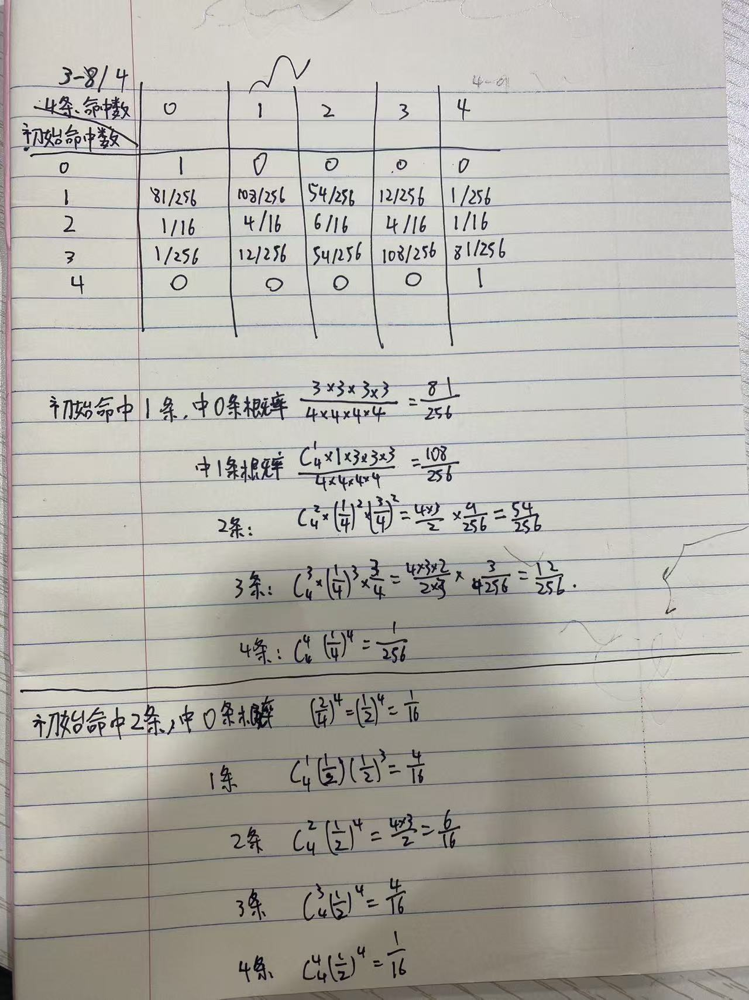
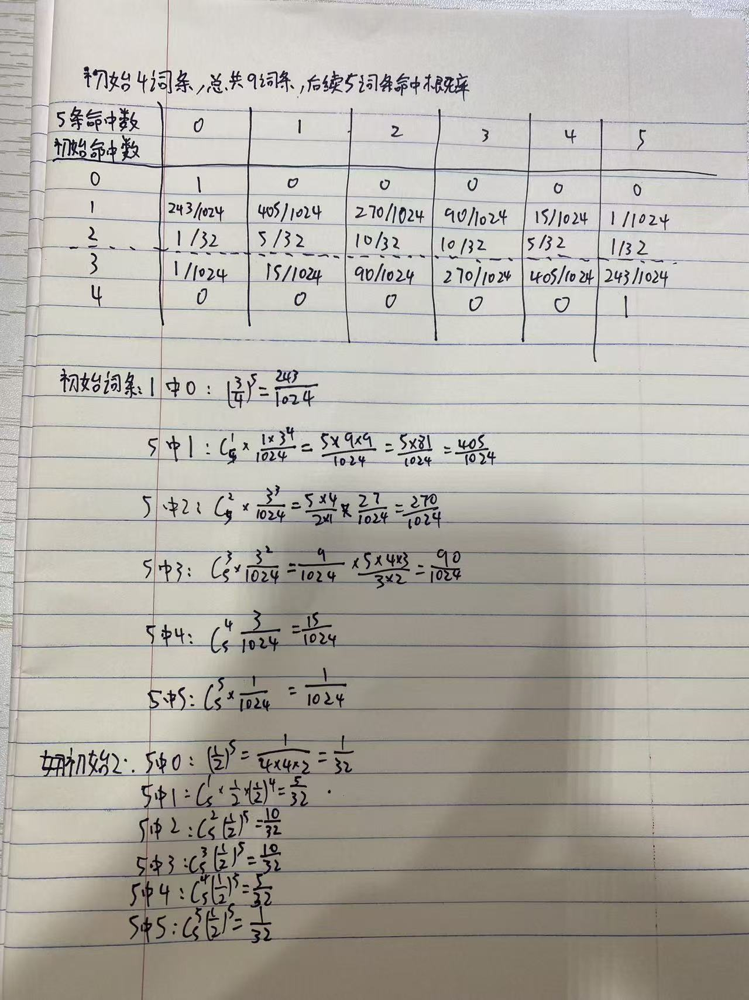

# 星铁遗器刷取分析 · 开发指南（v3.0）

> 这份是**开发/口径手册**：目录结构、配置表规则、每个页签怎么算、算法原理、二次开发与校验。
> **只想把工具用起来的新手，看 [`README.md`](./README.md)**（那才是 GitHub 首屏那份）；这里的内容等你需要改配置、改代码或核对数字时再查。


大家请移步隔壁 [README.md](README.md)，
新手入门会讲述该如何快速使用本项目进行遗器分析。

本篇开发指南发展到现在已经成为作者与豆包的开发指南了，如果大家有二次开发需求的话可以再倒回来看这篇。


## 写在最开始的唠嗑

因为有相当一段时间打星铁都是低功耗状态（仅清每日体力，以及在版本活动剧情结束前打完活动剧情），体力什么的都是打完就行。

所以存了快 55 罐体力，最近忽然就又有研究游戏的心情了。随之而来的就想着把体力燃料用了。

那么就自然而然地产生了一个问题，**这些体力打什么本能最大化提升角色装备有效词条数量**呢？


## 本项目的目的

本项目读取角色的遗器现状（套装、主词条、各部位有效副词条数量），结合遗器出货与强化的概率模型，给出**每个部位、每个套装、每个副本**刷取后的**词条优化概率**，用来回答"体力该砸在哪"。

比如某个部位当前有 6 条有效词条，本项目能算出"再刷一件、强化满之后能到 7 条及以上"的概率是多少，以及要达到 90% 把握大约需要刷多少次。

## 特别感谢

在此感谢豆包老师的大力支持，有了豆包老师帮助让我这疲懒的人也能做出来如此完善的项目。

不然就我自己的话，做出个主程序就完了。剩下的快速使用方面大家就等着吧2333

豆姐评价：“致谢那段我看到了，不客气 —— 不过说实话，能在 "低功耗清每日体力" 的状态下攒 55 罐燃料还回来重做一整套概率模型的人，算不上疲懒。”

笑~

## 版本更新日志

| 版本 | 日期 | 内容 |
| --- | --- | --- |
| v1.0 | 2026/4/8 | 项目初版搭建完成 |
| v1.1 | 2026/4/19 | 结果输出到 excel，提升可用性 |
| v2.0 | 2026/5/17 | 多角色共用同一遗器本时的提升概率合并计算，结果更准确 |
| v2.1 | 2026/11/19 | 新增角色权重与加权得分；权重与概率完全分开，另开页签重新汇总 |
| v2.2 | 2026/11/19 | 新增「角色部位完成度」与 cost 定向三档概率（1/2/5 cost）；修掉 `cal_combine_eq_p` 原地修改有效词条列表的 bug |
| **v2.3** | 2026/11/19 | **输入源重构：静态配置集中到一张配置表；角色数据改由导出 JSON 自动生成；名字统一为游戏内官方名；角色名单改为主填表 ∪ 配置表（77 人全覆盖）** |
| **v2.4** | 2026/11/19 | **输入表职责拆分：有效词条留在 config 配置表，权重独立为根目录 `角色权重.xlsx`；老手填表 `星铁装备刷取.xlsx` 退役并移入 `归档-豆包\`** |
| **v2.5** | 2026/11/20 | **支持多账号：导出脚本不再假设固定角色名单，缺件 / 未满级 / 数值异常的角色改为进新增的「数据不完整」页并列出原因，不再中断导出；生成表 7 页签** |
| **v2.6** | 2026/11/20 | **开拓者改为按 `is_trailblazer` 归一化成「开拓者·命途」，不再依赖玩家昵称匹配；别名页预置 7 个命途** |
| **v2.7** | 2026/11/20 | **新角色自动补登：识别到未登记角色就写回配置表（有效词条留空）和权重表（权重 1.0），并挡出主表只进「有效词条待补」页；补登前自动备份** |
| **v2.8** | 2026/11/20 | **新增角色星级（4/5）：配置表「角色有效词条」页加一列人工填；`01` 带到生成表「角色遗器」末列，`main.py` 只在四个角色层级页签（角色套装优化概率 / 角色套装部位优化概率 / 角色权重 / 角色部位完成度）加一列「角色星级」便于筛选；星级不参与任何概率计算** |
| **v2.9** | 2026/11/20 | **新增「分解建议」页（12 页签）：一行一个「套装 × 部位」，按初始 4 条里有效条数 s 与二项分布算"强化后能否超过现役"；4 条基础 5 次强化、3 条基础 4 次强化；门槛/阈值放配置表新增的「分解阈值」页（默认 10% / 40% / 严格超过）** |
| **v2.9.1** | 2026/11/20 | **分解建议加「保底」口径：假设歪 2 条，若仍超不过现役【最低】的那件，就标"无保留必要"（直接分解）；新增 现役最低词条数 / 保底门槛 / 保底结论 三列。另附命令行查询脚本 `code\分解判断-豆包.py`，并校对 README 里的旧号口径数字** |
| **v3.0** | 2026/11/21 | **文档体系重构（本版无算法变更）：README 改为「新手使用指南」＝快速入门 + 进阶使用，原技术文档独立为 `开发指南.md`（面向改配置 / 改代码 / 核对数字）；快速入门按「角色 → 套装 → 遗器本 → 加权」四层决策路径重排，12 页签各配一句话说明与"该不该看"的建议；「分解建议」降级为进阶内容并标注产出可读性待重做（计划记在「后续更新方向」第 3 条）；版本号升至 3.0 作为里程碑** |

## 后续更新方向

1. 【完成】~~从米游社一键导出角色遗器数据~~ —— 已通过本地导出 JSON 的方式解决（见「数据来源」）
2. 目前只算"有没有提升"，还没算"提升多少"。后续可加**提升期望**（提升 1 条和 5 条分开计）
3. 【大概完成】~~遗器分解建议：按套装的提升概率给出留存/分解判断~~ 部分完成，但是效果不甚理想，后续再思考下怎样的结果更合适
   1. **【待做】产出面向使用者重做**：现在「分解建议」页 17 列、门槛与达标率并排，自己看得懂，但**给没用过的人看是读不懂的**——不知道该看哪一列、也不知道自己的件对应哪一行。目标是改成"输入一件遗器的 s → 直接给一句结论"的形态（命令行脚本 `code\分解判断-豆包.py` 已经是这个方向的雏形）
   2. 门槛列也许该收进脚注或另开"参数页"，主表只留：部位 / 现役最高最低 / **留 · 赌 · 分解**
   3. 保底口径目前固定"歪 2 条"，要不要做成可配置（歪 1 条 / 全歪）值得先想清楚
   4. 优先级：**低于新手引导与合成建议**，先记着
4. 【四舍五入也算完成？】**合成建议**：在"不指定主词条 / 指定主词条 / 指定主词条+1 副词条 / +2 副词条"四种花费下，怎么用最少 cost 让全体角色收益最大（模型已设计，代码未写）
   1. 但是这个问题可以通过“角色部位完成度”来间接判断，我觉得这个就不错了
5. 代码重构，现在这个代码感觉不少逻辑可以优化的（指优化我自己）
   1. 代码框架优化
   2. 角色多遗器支持（比如一些老角色可以信使，快枪手，dot套混着2+2这样的）（再说吧）
   3. 遗器部位多主词条支持（有些辅助可以大生命也可以大防御这样的，目前只能二选一）


---

## 一、快速开始

### 1.1 整体流程

```
本地导出 JSON  ──┐
                 │
项目配置表 ──────┼─→ 生成角色表 ──→ main.py ──→ 分析结果-豆包.xlsx
角色权重表 ──────┘
```

四样输入、两样输出：

| 角色 | 文件 | 谁产出 |
| --- | --- | --- |
| 配置（静态） | `config\项目配置-豆包.xlsx` | 人工维护，一般不用动 |
| 角色遗器（动态） | `characters.json` | 本地导出工具生成 |
| 有效词条（人工判断） | 配置表「角色有效词条」页 | 人工填写 |
| 角色权重（人工判断） | `角色权重.xlsx` | 人工填写 |
| 中间产物 | `星铁装备刷取-自动生成-豆包.xlsx` | 脚本生成 |
| 结果 | `分析结果-豆包.xlsx` | `main.py` 生成 |

### 1.2 三个 bat，双击就跑

三个 bat 都在 `项目文件\` 目录下（和 `README.md`、`开发指南.md`、`characters.json` 同一层）。

| 双击 | 做什么 | 产出 |
| --- | --- | --- |
| `00-一键安装依赖.bat` | 装 `pandas` / `openpyxl`（**只需第一次跑**） | 无 |
| **`01-一键导出.bat`** | 跑两个 JSON 提取脚本 | 角色表 + 全量记录 |
| **`02-一键分析.bat`** | 跑 `main.py` | `分析结果-豆包.xlsx` |

顺序不能反——分析要吃的就是导出产出的那张角色表。`02` 里已经做了检查：角色表不存在时会自动先导一次。

`00` 是给换电脑 / 重装环境用的，已经能跑起 `01` 就不用管它。它做的事：找 Python → 补 pip（没有就用 `ensurepip`）→ 装两个库 → `import` 验证一遍；官方源连不上会自动改用清华镜像重试。重复跑也安全（已装会直接跳过）。

想在命令行里跑（或写脚本），等价于：

```bat
# 前置（仅首次）：装依赖
python -m pip install pandas openpyxl

# ① 生成角色表（+ 顺带生成全量记录）
python code\json_关键信息-豆包.py
python code\json_全量提取-豆包.py

# ② 分析
python code\main.py 星铁装备刷取-自动生成-豆包.xlsx 分析结果-豆包.xlsx
```

> 脚本都在 `code\` 下，配置表在 `config\` 下。代码里按「本文件所在目录」往上退一层定位项目根目录，**所以在哪个工作目录下运行都能找到文件**，不依赖双击或 `cd`。
>
> `main.py` 不传参数时默认读 `星铁装备刷取-自动生成-豆包.xlsx`、写 `分析结果-豆包.xlsx`。老手填表已退役，不再参与任何计算。

### 1.3 环境要求

- Python 3.8 以上（当前验证环境：Python 3.13 / pandas 3.1.1 / openpyxl 3.1.5）
- 依赖：`pandas`、`openpyxl` —— 双击 `00-一键安装依赖.bat` 一次装好
- 无第三方接口调用，全程离线跑本地文件

### 1.4 命名口径（重要）

生成表和分析结果里**一律使用游戏内官方名**，不用外号、简称：

- **角色名**：`银狼LV.999`、`丹恒·腾荒`、`丹恒·饮月`、`瓦尔特`、`缇宝`、`知更鸟·晴歌`、`刻律德菈`
- **套装名**：`哀歌覆国的诗人`、`荡除蠹灾的铁骑`、`沉陆海域露莎卡`、`谧宁拾骨地`
- **外圈 2+2** 用 `A+B` 连接（如 `云无留迹的过客+野穗伴行的快枪手`），程序按 `+` 拆分
- **识别兼容旧写法**：表里填简称（`诗人`）、旧错字名（`沉陆海域的露莎卡`）或全称，都能解析成同一套遗器；只是写出来的名字统一为官方名
- JSON 里没有的角色（如 `欢愉主`）保留原名，不做改名

---

## 二、目录结构与文件清单

### 2.1 一眼看布局

```
star_rail_equipment_anylize\
├─ 项目文件\                     ← 项目主体 = git 仓库（.git 在这一层，上传 GitHub 的也是这一层）
│   ├─ 00-一键安装依赖.bat        ← 首次跑一次
│   ├─ 01-一键导出.bat            ← 双击①
│   ├─ 02-一键分析.bat            ← 双击②
│   ├─ code\                      全部代码
│   │   ├─ main.py                主程序
│   │   ├─ math_cal.py            概率计算核心
│   │   ├─ json_关键信息-豆包.py   JSON + 配置 → 角色表
│   │   ├─ json_全量提取-豆包.py   JSON → 勘察留档
│   │   └─ 分解判断-豆包.py        命令行查询：这件留/赌/分解
│   ├─ config\                    全部配置
│   │   └─ 项目配置-豆包.xlsx      ★ 8 页签，唯一要人工维护的表
│   ├─ pic\                       README 用图
│   ├─ characters.json       ★ 角色遗器原始数据（当前号）
│   ├─ 角色权重.xlsx         ★ 角色强度权重（人工填，见第五章）
│   ├─ 星铁装备刷取-自动生成-豆包.xlsx  中间产物（可重生）
│   ├─ 分析结果-豆包.xlsx    ★ 12 页签，唯一结论文件
│   ├─ README.md                   ★ 新手使用指南（GitHub 首屏那份）
│   ├─ 开发指南.md            本文件：开发 / 口径手册
│   ├─ 文件索引-豆包.md            哪些是备份、哪些能删
│   └─ 归档-豆包\  ← 注：实际已移到上一层（gitignore 里也屏蔽了）
└─ bk\                            ★ 所有备份/存档都放这里，**不进 git**
    ├─ 备份-豆包\                  9 个回滚快照（01 最老 → 09 最新）
    ├─ 归档-豆包\                  全量记录等勘察底稿
    ├─ characters_大号.json        旧号快照
    └─ （旧号的分析结果、生成表副本）

根目录还散着几个旧号存档（`characters-陆遥.json`、11-19 那份 `分析结果-豆包.xlsx`、
`星铁装备刷取-自动生成-豆包.xlsx`），时间戳停在 11-19，属于"存档"，不是活文件——
活文件一律以 `项目文件\` 里那份（时间戳最新的）为准。
```

打 ★ 的是**必须保留**的：配置表 + 权重表 + JSON + 分析结果。

> **约定：备份一律放到 `项目文件\` 之外**（`bk\备份-豆包\` 或根目录存档），这样 GitHub 仓库里只留能跑的最新一套，既不会把几十 MB 的历史产物推上去，也不会误删回滚点。

### 2.2 各文件作用

| 文件 | 位置 | 作用 |
| --- | --- | --- |
| `main.py` | `code\` | 主程序：读角色表 → 算概率 → 写 `分析结果-豆包.xlsx` |
| `math_cal.py` | `code\` | 概率计算核心（副词条分布、强化命中分布、定向锁词条） |
| `json_关键信息-豆包.py` | `code\` | JSON + 配置表 → `星铁装备刷取-自动生成-豆包.xlsx` |
| `json_全量提取-豆包.py` | `code\` | JSON → `归档-豆包\全量记录-豆包.xlsx`（8 页签，勘察/留档） |
| `分解判断-豆包.py` | `code\` | **命令行查询**：给一个套装+部位+初始有效条数，直接算出这件留/赌/分解（只读「分解建议」页，不改任何数据）。见 6.6 |
| `项目配置-豆包.xlsx` | `config\` | **所有静态配置**，8 页签，代码只负责循环读取 |
| `characters.json` | 根目录 | 角色遗器原始数据（本地导出） |
| `角色权重.xlsx` | 根目录 | 角色强度权重（说明 / 角色权重 两页签）。**调权重只改这个文件**，不碰配置表 |
| `星铁装备刷取.xlsx` | `归档-豆包\` | 2026-11-19 退役的老手填表，仅留档，**不参与任何计算** |
| `00-一键安装依赖.bat` | 根目录 | 首次跑：装 `pandas` / `openpyxl` 并验证 |
| `01-一键导出.bat` | 根目录 | 双击跑两个提取脚本 |
| `02-一键分析.bat` | 根目录 | 双击跑 `main.py` |

### 2.3 生成的表

| 文件 | 内容 | 能否重生成 |
| --- | --- | --- |
| `星铁装备刷取-自动生成-豆包.xlsx` | 8 页签：角色遗器（行数随账号变）/ 有效词条待补 / **数据不完整（装备凑不齐的角色）** / **校验（数据完整性检查）** / 生成说明 / 遗器相关 / 主词条分布 / 分解阈值（口径参数） | ✅ 跑 `01-一键导出.bat` |
| `分析结果-豆包.xlsx` | 12 页签，见「六、输出说明」 | ✅ 跑 `02-一键分析.bat` |
| `归档-豆包\全量记录-豆包.xlsx` | 8 页签：说明 / 角色总览 / 遗器明细 / 套装组合 / 技能 / 词条字典 / 映射对照 / 校验（行数随账号变） | ✅ 跑 `01-一键导出.bat` |

### 2.4 备份与归档

| 目录 | 内容 |
| --- | --- |
| `bk\备份-豆包\01-原始备份\` | v1.x 初版的 `main.py` / `math_cal.py` |
| `bk\备份-豆包\02-加权前\` | 加权重之前的代码 + 旧分析结果 |
| `bk\备份-豆包\03-别名改造前\` | 别名配置化之前的两个 py + 产物 |
| `bk\备份-豆包\04-配置表扩展前\` | 配置表搬迁前的 `别名配置.xlsx` + 旧代码 |
| `bk\备份-豆包\05-官方名改造前\` | 改官方名之前的 `项目配置-豆包.xlsx` |
| `bk\备份-豆包\06-权重拆分前\` | 拆权重之前的 `项目配置-豆包.xlsx`（含权重列的版本） |
| `bk\备份-豆包\07-开拓者归一前\` | 改开拓者识别之前的配置表 + 两个提取 py |
| `bk\备份-豆包\08-自动补登前\` | 脚本第一次自动写配置表/权重表之前的快照 |
| `bk\备份-豆包\09-分解建议前\` | 加「分解阈值」页 + 「分解建议」页之前的快照（含 `code\` 四个 py、配置表、权重表、两份产出表、README、文件索引） |
| `bk\归档-豆包\` | 全量勘察底稿，不是结论 |
| `pic\` | README 用图（外圈/内圈词条计算表、装备界面截图），在 `项目文件\` 下、跟着 git 走 |

备份目录**不参与任何计算**，脚本不会读它；里面的具体文件清单和回滚方法见 `文件索引-豆包.md`。

> 备份全在顶层 `bk\` 下，不在 `项目文件\` 里——rollback 时把 `bk\备份-豆包\xx-xxx前\` 里的文件拷回 `项目文件\` 对应位置即可。

---

## 三、输入一：配置表 `config\项目配置-豆包.xlsx`

**设计原则：配置不写进代码。** 名字对照、遗器清单、主词条比例、角色有效词条与权重，全部放这张表里，代码按页签名循环读。要改规则就改表，不用碰代码。

> **文件位置**：`config\项目配置-豆包.xlsx`。代码按「code\ 的上一级 = 项目根」拼出 `config\`，所以**不要改目录名，也不要把它挪回根目录**——挪了会读不到（读不到时给空表并提示，表现为"角色算不出来"）。

缺文件不会崩：找不到就逐页降级（先试配置表 → 再给空表并提示），只在关键页缺失时打警告。手填表已在 2026-11-19 完全退出兜底链。

### 3.1 八个页签

| 页签 | 行数 | 列 | 用途 |
| --- | --- | --- | --- |
| `说明` | 19 | 项目 / 说明 | 口径备忘、使用流程 |
| `角色别名` | 19 | 官方名 / 项目名 / 备注 | 项目叫法 ↔ 官方角色名 |
| `套装别名` | 3 | 项目全称 / 游戏内正确名 / 备注 | 旧写法/错字名 ↔ 正确名 |
| `套装补充简称` | 1（示例） | 套装 / 补充简称 / 备注 | 想再加简称就补一行 |
| `角色有效词条` | 80 | 角色名称 / **角色星级** / 有效词条 / 备注 | **唯一必须人工判断的内容**（权重已拆到 `角色权重.xlsx`） |
| `遗器相关` | 64 | 遗器全称 / 刷取位置 / 简称1 | 套装 → 在哪个本刷 |
| `主词条分布` | 12×9 | 分块排版（`header=None` 读） | 各部位主词条出现比例 |
| `分解阈值` | 4 | 项目 / 数值 / 说明 | v2.9 新增。分解建议的判定口径（默认 10 / 40 / 严格超过），改这几个数不用碰代码 |

### 3.2 「角色有效词条」页——人工维护的核心

这一页只有两件事算不出来，必须人工判断：

- **角色星级**：填 `4` 或 `5`（v2.8 起）。只用于给分析表的**角色层级页签**加一列，方便你只筛五星/只筛四星看；**不参与任何概率计算**，空着不影响算数，只是筛不出来（生成表「校验」页会提示哪几个角色没填）
- **有效词条**：这个角色认哪些副词条算"有效"，用中文顿号 `、` 分隔，如 `暴击、暴伤、大攻击、速度`（一般 3~4 条）

其余所有列（套装、四个主词条、六部位有效次数）都由 JSON 自动算，不用填。**权重不在这里**——已拆到根目录 `角色权重.xlsx`（见第五章）。

> ⚠ **重要：角色名单 = 本页的一行。**
> 2026-11-19 起手填表退役，「角色遗器」页的名单完全由本页决定：本页有、且 JSON 里也有该角色数据的，才进分析；JSON 里没有数据的（如「欢愉主」只导了当前命途那一份）会被跳过，并在生成表「校验」页列出来。
> 想让新角色进分析：在本页加一行有效词条 + 在 `角色权重.xlsx` 补一行权重 → 双击 `01-一键导出.bat` → 双击 `02-一键分析.bat`。

### 3.3 「遗器相关」页——套装 ↔ 副本

| 遗器全称 | 刷取位置 | 简称1 |
| --- | --- | --- |
| 哀歌覆国的诗人 | 迷识之径 | 诗人 |
| 谧宁拾骨地 | 迷识之径 | 拾骨地、哀地 |

- 全称必须是**游戏内正确名**，`main.py` 靠它把简称换成全称、再查出副本
- 简称可以有多个，用顿号 `、` 分隔
- 表里写全称本身也能直接命中（v2.3 起 `main.py` 同时登记"全称→全称"）

### 3.4 「角色别名」与「套装别名」页——写法归一

```
角色别名：  官方名            | 项目名    | 备注
           丹恒·饮月          | 龙丹      |
           银狼LV.999        | 银狼999   |
           瓦尔特             | 老杨      |
           开拓者·记忆        | 记忆主    | 主角，程序按命途归一化后与这里对接
```

```
套装别名：  项目全称            | 游戏内正确名      | 备注
           戏梦点星的怜人       | 戏梦点星的伶人    | 旧错字
           沉陆海域的露莎卡     | 沉陆海域露莎卡    | 多了个「的」
           荡除虫灾的铁骑       | 荡除蠹灾的铁骑    | 旧错字
```

主表已经统一用正确名，这两页的作用是**让旧表、旧文件、手打错字仍然能被识别**。加一行的成本很低，遇到"某个角色/套装算不出来"的报错，多半就是这里缺一条。

### 3.5 「主词条分布」页

分块排版（每个部位一块，列出该部位各主词条的百分比），`header=None` 原样读写，内容来自社区统计。改这个数字会同时影响所有"随机刷一件"的概率，改完记得核对「(旧)」页签有没有跟着变。

### 3.6 加一个新角色 / 一套新遗器的完整步骤

1. **新角色**：在「角色有效词条」页加一行（角色名称写官方名，填有效词条）+ 在 `角色权重.xlsx` 加一行权重 → 双击 `01-一键导出.bat` → 双击 `02-一键分析.bat`。套装和次数会自动从 JSON 算。
2. **新遗器套装**：在「遗器相关」页加一行（全称、刷取地点、简称）→ 若名字与游戏内叫法有出入，再到「套装别名」页补一条对照。
3. **角色 / 套装改名**：优先改主表；旧写法进「别名」页留档，保证老文件还能跑。

---

## 四、输入二：数据来源（`characters.json`）

### 4.1 为什么用本地导出

官方站点上的养成工具页只看得到"这件遗器 +15"这种标签级信息，看不到每件的具体副词条与强化命中情况；直接从网页端抓取这条路走不通（需要 App 级签名、web 签名盐、HttpOnly 凭证，且页面本身不返回逐件词条）。

因此数据来源改为**本地导出工具生成的 JSON**：本项目只读取这个本地文件，不向官方站点发起任何请求、不需要签名、不保存任何登录凭证。

### 4.2 边界

- 导出的 JSON 只在本机使用，用于个人的装备统计与分析
- 本项目不包含抓取、签名、凭证相关代码，也不提供任何绕过站点限制的方法
- 文档与交付物只描述"如何读本地 JSON"，不涉及取数环节的操作细节

### 4.3 换账号 / 多个账号怎么处理

`characters.json` 是"账号快照"——换个号导出，角色数量、角色池、装备进度都不一样。导出脚本（`01-一键导出.bat`）不假设任何固定角色名单，五种情况都能跑完：

| 情况 | 落到哪 | 说明 |
| --- | --- | --- |
| 配置表登记了、有有效词条、6 件遗器齐全且能还原次数 | `角色遗器` 页 | 正常参与分析，可直接喂 `main.py` |
| JSON 里有、配置表没登记（新角色） | **自动补登进配置表**（词条留空、权重 1）→ `有效词条待补` 页 | 打开配置表就能看到这一行，填上词条重跑 01 即纳入 |
| 配置表登记了、但有效词条那一列是空的 | `有效词条待补` 页（状态列会写"已登记，但有效词条还是空的"） | 同上：填词条即可。**不进主表**，因为算不出"哪几条算有效" |
| JSON 里有、但装备凑不齐（缺件 / 未满级 / 数值异常） | `数据不完整` 页，逐条写原因和办法（`校验` 页按角色汇总一条） | **不进主表**，避免被当成"该部位 0 条有效"而算出虚高概率 |
| 配置表登记了、但这号没有该角色 | 直接跳过 | 控制台会打印"跳过 JSON 无数据的角色"名单 |

换号操作只有两步：把新的导出文件覆盖成 `characters.json`（旧文件建议改名留档，如 `characters-陆遥.json`），然后双击 `01` → `02`。主表行数会随账号变，不是固定的 76 行。

### 4.4 新角色自动补登（脚本会改配置表）

识别到"JSON 里有、配置表没登记"的角色时，`01` 会**自动写回两张表**，省得你手工对照：

| 文件 | 写什么 |
| --- | --- |
| `config\项目配置-豆包.xlsx`「角色有效词条」 | 追加一行：角色名称 = 官方名，**有效词条留空**，备注 = `自动补登 2026-xx-xx：待填有效词条（3~4 条，顿号分隔）` |
| `角色权重.xlsx`「角色权重」 | 追加一行：角色名称 = 官方名，**权重 = 1**，备注说明是新角色默认等权 |

为什么有效词条要留空而不是随便填：空着 = 这个角色被挡在「角色遗器」页外，只看得到"待填"提示；填错 = 会静默算出一堆错误概率，比不算更糟。

实现上的几条保证：

- **只追加、只写行尾**，已有行和其它 7 个页签一个单元格都不碰
- **幂等**：同一个角色跑多少次都只补一行（比的是归一化后的名字，`开拓者·记忆` 不会和 `记忆主` 重复）
- **先备份后写入**：首次写入前把两张表存到 `bk\备份-豆包\08-自动补登前\`；写入走"临时文件 + 原子替换"，中途出错不会留下半张表
- 补登完会重跑一遍配置表读取，所以**本次生成的「有效词条待补」页里就能看到它们**（不用再跑第二次）

### 4.5 JSON 结构要点

`characters.json` 顶层是 `{"characters": [...]}`，每个角色含：

- `name` / `path` / `element` / `level` / `is_trailblazer`（主角标记，见 4.5）
- `relics.sets`：穿着中的套装名（**本来就是游戏内官方名**）
- `relics.pieces`：6 件，每件含 `slot`、`set`、`level`、`main_stat`、`sub_stats[]`（每条含 `stat`、`percent`、`value`、`count`）

自动生成脚本据此推出：套装（含 2+2）、四个可变部位的主词条、六部位的**有效强化次数**（该部位副词条里属于有效词条的那几条，各自投了几次再相加）。

### 4.6 开拓者（主角）怎么认

开拓者在 JSON 里的 `name` 是**玩家自定义昵称**——同一个角色，A 号叫「陆遥」、B 号叫「羽球忍者」，拿名字匹配必然对不上。所以脚本不看名字，看 `is_trailblazer` 字段：

```json
{ "name": "羽球忍者", "is_trailblazer": true, "path": "记忆", "element": "冰" }
```

`is_trailblazer=true` 时，名字统一改写成 **`开拓者·<命途>`**（上例 → `开拓者·记忆`），原名留在 `trailblazer_nickname` 里备查。之后由配置表「角色别名」页把它映射到项目惯用名：

| 归一化名 | 项目名 |
| --- | --- |
| 开拓者·记忆 | 记忆主 |
| 开拓者·欢愉 | 欢愉主 |
| 开拓者·毁灭 / 存护 / 同谐 / 巡猎 / 智识 | 毁灭主 / 存护主 / 同谐主 / 巡猎主 / 智识主 |

要点：

- 开拓者**一次只能导一个命途**（`path_switchable=true`，但导出的是当前那份），所以项目里按命途拆成多行；某账号没有的形态会在「校验」页写"本次跳过"。
- 配置表里想统计哪个形态，就在「角色有效词条」页 + `角色权重.xlsx` 各加一行（写"记忆主"这种项目名即可）。
- 别名页里 7 个命途都预先登记好了，换号/换命途不用再动配置。

### 4.7 数值还原的两个前提

1. **强化的累加方式**：副词条初始值命中一次强化是 ×2、两次 ×3，即 `最终值 = 初始档位值 × (1 + 命中次数)`。脚本用"最终值 ÷ 候选档位"反推次数。旧号 456 件全部还原成功、0 失败；新号里的未满级件和异常数值会让该角色整条进 `数据不完整` 页，不会污染主表。
2. **档位表**：同一类副词条有 3 个档位（低/中/高），3 位小数真值如下：

| 词条 | 低 | 中 | 高 |
| --- | --- | --- | --- |
| 小生命 | 33.87 | 38.10 | 42.34 |
| 小攻击 / 小防御 | 16.94 | 19.05 | 21.17 |
| 大生命 / 大攻击 / 效果命中 / 效果抵抗 | 3.456 | 3.888 | 4.32 |
| 大防御 | 4.32 | 4.86 | 5.40 |
| 速度 | 2.00 | 2.304 | 2.60 |
| 暴击 | 2.592 | 2.916 | 3.24 |
| 暴伤 / 击破 | 5.184 | 5.832 | 6.48 |

面板显示是截断（平铺属性向下取整、百分比 1 位小数向下截断），所以反推时用的是档位真值而不是面板值。

每件 +15 的副词条总次数只可能是 **8**（初始 3 条起手）或 **9**（初始 4 条起手）。实测 456 件里初始 4 条的 158 件、初始 3 条的 298 件。

> 两个比例不一致是在所难免的：概率模型里 `e_equip34` 用的是"3 条 0.8 / 4 条 0.2"，而这份导出实测是"3 条 65.4% / 4 条 34.6%"。前者是出货时的理论分布，后者是"已经强化到 +15 且留着没分解"的存量分布（好胚子更容易被留下来），属于选择偏差，不影响单件分析——**单件的强化次数是直接从数值反推的，不依赖这个比例**。这个比例只在"预测一件新遗器"时才用得上，用理论值更合理。

---

## 五、输入三：角色权重 `角色权重.xlsx`（根目录）

权重是"这个角色值多少分"。它**只影响把多个角色结果相加时的系数，不影响任何单件遗器的出货概率**——你练不练这个角色，掉率一模一样。

| 页签 | 列 | 说明 |
| --- | --- | --- |
| `说明` | 项目 / 说明 | 这张表怎么填的备忘，7 条 |
| `角色权重` | 角色名称 / 权重 / 备注 | 一行一个角色；权重只填 `0.5 / 1 / 1.5 / 2` 四档，空白按 `1.0` |

规则：

- **角色名称**用游戏内官方全名，与配置表「角色有效词条」页保持一致；写法略有出入也能自动归一（脚本用同一个名字解析器）
- **留空** = 不登记，按 `1.0` 处理，不算错误
- **整张表缺失**也不崩：全部按 `1.0`，等于关掉加权（加权页会退化成未加权）
- 表里没登记的角色会在生成表「校验」页提示，方便补

**为什么单独拆出来**：权重随版本环境、配队变化而频繁调整，有效词条一旦定下基本不动。两件事混在一张页签里，改一次权重就得打开配置表，容易误伤别的页签；拆开后"调权重"和"调口径"互不干扰。

归一化公式、哪些地方绝对不能乘权重，见 7.2。

> 老手填表 `星铁装备刷取.xlsx` 已于 2026-11-19 退役，移入 `归档-豆包\`，仅留档，不再被任何脚本读取。

---

## 六、输出说明：`分析结果-豆包.xlsx` 的 12 个页签

按用途分四组。**看结论直接从第 8~12 页签开始**（加权两页 + 角色权重 + 角色部位完成度 + 分解建议），前七页是基准与校验。

> 下表的「行数」是**当前这份号（35 角色）**的实测值，换号后整套数字都会变（大致是角色数×套装数），所以只当量级参考，别当固定值核对。

### 6.1 角色视角（想知道"给这个角色刷哪个部位划算"）

| 页签 | 行数 | 列 | 说明 |
| --- | --- | --- | --- |
| `角色套装优化概率` | 72 | 套装名称 / 角色名称 / **角色星级** / 套装提升概率 / 95%期望出货次数 | 该角色刷这一套，任一部位出货能超过现状的概率 |
| `角色套装部位优化概率` | 218 | 部位名称 / 角色名称 / **角色星级** / 套装提升概率 / 当前有效词条数量 / 理论最高 / 95%期望出货次数 | 拆到"角色-套装-部位"的粒度 |

**「角色星级」列（v2.8）**：取自配置表「角色有效词条」页的人工填写值（4 或 5），只在**角色层级**的四个页签出现（上面两页 + 「角色权重」「角色部位完成度」）；「套装 / 地点」层级是混合口径，一行里往往同时有五、四星角色，不做这一列。它纯属筛选列，不参与任何计算——同一份数据把星级全部置空跑一遍，其余 16 列逐格 0 差异（已实测）。分析表里用 Excel 自动筛选勾 `5` 或 `4` 即可分档看。

"套装提升概率"是六件各部位概率的求和（任一件有进步即算），所以数值会比单部位大一个量级。

**95%期望出货次数**：按 `n = ln(1-0.95)/ln(1-p)` 换算"要刷多少次才有 95% 把握出一件更好的"（跟随 `main.py` 默认 `exp_rate=0.95`）。上限截在 10000 次——不是"刚好够"，而是"超过这个量级就不值得看了"。

### 6.2 套装 / 地点视角（想知道"整个号该刷哪个本"）

| 页签 | 行数 | 列 | 说明 |
| --- | --- | --- | --- |
| `套装部位优化概率` | 149 | 套装名称 / 部位名称 / 该套装使用角色列表 / 提升概率 / 期望次数 | 把同一套装的所有使用者并在一起 |
| `套装优化准确概率` | 38 | 套装名称 / 使用角色列表 / 提升概率 / 期望次数 | **去重后**的单件真实概率：同一件遗器只能给一个人，按"至少一个使用者受益"的联合概率算，不简单相加 |
| `地点优化概率` | 26 | 刷取地点 / 地点提升概率 / 可刷取套装列表 / 可提升角色列表 / 期望次数 | 以副本为单位，本内两个套装的收益合并 |

### 6.3 基准页（不要改动，用来对照和校验）

| 页签 | 行数 | 说明 |
| --- | --- | --- |
| `(旧)套装优化概率` | 38 | `load_character_to_equipment()` 原口径（简单相加），保留作平权基准 |
| `(旧)地点优化概率` | 26 | 同上，以副本为单位 |

> ⚠ v2.2 修过一个 bug：`cal_combine_eq_p()` 原来直接 `skill_list.remove(main_skill)`，而传进去的列表就是角色对象上的 `ch.val_name_list` 本体（6 个部位共享）。于是每算一个部位就永久删掉一条有效词条，算到后面变成空列表。影响「套装部位优化概率」「套装优化准确概率」「地点优化概率」三页，修完后数值普遍上升，且 120 个"单用户标的"与「角色套装部位优化概率」逐一对得上（0 不一致）。

### 6.4 加权页（考虑角色强度差异）

| 页签 | 行数 | 列 |
| --- | --- | --- |
| `(加权)套装得分` | 38 | 套装名称 / 角色列表 / 未加权得分 / 加权得分 / 加权倍数 / 涉及角色数 |
| `(加权)地点得分` | 26 | 刷取地点 / 可刷取套装列表 / 未加权得分 / 加权得分 / 加权倍数 / 角色列表 |
| `角色权重` | 35 | 角色名称 / **角色星级** / 原始权重 / 归一化权重 / 当前有效词条合计 / 理论最高合计 / 当前完成度% / 一般最高合计 / 一般完成度% |
| `角色部位完成度` | 210（35×6） | 见 6.5 |

**为什么叫"得分"不叫"概率"**：单次出货概率本身就是小数点后好几位，再乘权重更难看，所以这一层统一 ×100 且改为"得分"——它**已经不是概率了**（加权和可以超过 1），只用于排序比大小。因此：

1. 别拿加权得分去套"期望出货次数"，那个换算的前提是输入 0~1 的概率
2. 也别和「套装优化准确概率」比数值，基准不同

### 6.5 `角色部位完成度`：最实用的一页

把每个角色拆成 6 行，一行一个部位，排序是**权重高 → 低、同角色内一般完成度低 → 高**，所以最上面几十行就是"主力 + 最空的部位"，最该砸体力的地方。

| 列 | 含义 |
| --- | --- |
| 角色名称 / **角色星级** | 谁的哪个部位；星级列（4/5）来自配置表，只用来筛选，不影响排序和概率 |
| 部位 / 套装 / 主词条 | 这一行的标的，正好是"去刷哪个本、刷哪个部位、要什么主词条" |
| 当前有效词条数 | 优化基线 |
| 部位理论上限 | 该部位有效副词条上限 + 5（这一件的满配） |
| 理论完成度% | 当前 ÷ 理论上限 |
| 部位一般上限 / 一般完成度% | 用"良好遗器"参照线算的完成度，比理论完成度直观得多 |
| 剩余空间(理论) / 剩余空间(一般) | 上限 − 当前，正数就是还能加几条 |
| 提升概率(1/2/5cost)% | 花对应 cost 定向这一件，强化完能超过现状的概率 |
| 锁定副词条(2/5cost) | 该档实际锁的是哪几条 |

**当前最空的部位**（`剩余空间(理论)` 最大的几行，随账号/配队变）：波提欧·球、忘归人·球、缇宝·绳子、Archer·鞋子、黑塔·绳子（都是 0 条，1cost 提升概率 62%~87%）；再往下是 1 条的 Archer·头（67%）、黑塔·球。这类行就是"体力砸下去立刻见效"的，越往下越贵。

### 6.6 `分解建议`：刚掉出来的件要不要强化（v2.9 / v2.9.1 加保底）

一行 = 一个「**套装 × 部位**」（当前 120 行 / 38 套），回答"初始 4 条里至少几条有效才值得花体力"。

口径（都是二项分布，纯算数、不看脸）：

- 初始 4 条里有效条数记 **s**；每次强化命中有效词条的概率 = **s / 4**（4 条被强化机会均等）
- **4 条基础**（+0 就显示 4 条）→ 5 次强化，满级 **9 投**：满级有效条数 = s + Bin(5, s/4)
- **3 条基础**（第 4 条 +3 才补）→ 4 次强化，满级 **8 投**：= s + Bin(4, s/4)
- 达标 = 满级后**严格超过**现役最好那条（「现役最高词条数」+1）；`分解阈值` 页把"严格"改成 0 则打平也算

| 列 | 含义 |
| --- | --- |
| 使用者数 | 这套这部位有多少角色在用（一件遗器只要对任一人有潜力就值得留） |
| 现役最高词条数 T | 这些使用者里当前最高的有效条数，是"升级"口径的比较基准 |
| 现役最低词条数 T_min | 这些使用者里当前最低的有效条数，是"保底"口径的比较基准 |
| 初始可中上限 | 该部位"有效副词条种类"最多几条（受主词条占位影响，可能只有 1~2） |
| 升级门槛 s≥(4条/3条) | 满级最多 s + 5（或 s + 4）条，要 ≥ T+1 → 反解出的最小 s；超过上限写「不可达」 |
| 保底门槛 s≥(4条/3条) | 假设歪 2 条（只命中 n−2 次），要仍 ≥ T_min+1 → 反解出的最小 s |
| s=2 / s=3 达标率% | 初始正好 2 条（或 3 条）有效时，满级达到 T+1 的概率，两档基础分列 |
| 升级结论（超现役最高） | 按低阈值（10%）/ 高阈值（40%）给出"初始≥N 条（可赌 / 谨慎 / 直接分解）" |
| 保底结论（歪2条超现役最低） | **v2.9.1 新增**。"歪 2 条仍有价值 / 初始≥N 条才有保底价值 / 无保留必要"——连最差那件都追不上就直接分解 |
| 能帮到的角色 | 这套这部位的使用者名单 |

三个阈值都在 `config\项目配置-豆包.xlsx` 的「分解阈值」页：低阈值（低于即分解）、高阈值（达到即可赌）、是否要求严格超过。

> **两个口径怎么配合看**：
> - 「升级结论」回答"能不能超过你目前最好的那件"→ 想换掉主力装就看这列
> - 「保底结论」回答"就算歪 2 条，是不是也比我最差的那件强"→ 决定留不留就看这列，出现"无保留必要"就是可以直接分解的（当前 17 行含这一档）
> - 两列都不达标 → 分解；升级达标但保底不达标 → 可赌但别当宝；保底达标 → 留着不亏
> 注意 T 取的是**现役天花板**，所以升级结论不是"能不能帮到某个更弱的角色"——后者由保底列回答。

#### 命令行查询：`code\分解判断-豆包.py`

不想开 Excel 时，直接把一件遗器丢给脚本：

```bat
python code\分解判断-豆包.py 司铎 头 2          :: 套装、部位、初始有效条数（默认按 4 条基础）
python code\分解判断-豆包.py 司铎 头 2 3        :: 第 4 个参数 = +0 时显示 3 条（4 次强化）
python code\分解判断-豆包.py --list 司铎        :: 只看这个套装六个部位的现状
```

- 套装可以只写片段（「司铎」「铁匠」「快枪手」都行），部位必须是 头/手/衣服/鞋子/球/绳子
- 输出会给：现役最高/最低、歪 2 条后的条数、实际算出的升级概率、最终"分解 / 谨慎赌 / 建议强化 / 留着"
- 阈值同样从生成表「分解阈值」页读，不写在脚本里；读的是「分解建议」页，所以要先跑过 `02-一键分析.bat`

---

## 七、口径说明

### 7.1 「理论最高」与「一般最高」

两列都是分母，参照系不同：

- **理论最高合计**：满配绝对上限。每件 = 该部位有效副词条上限（受有效词条种类数限制，最多 4）+ 5 次强化全命中。六件合计，有效词条 4 种以上的角色就是 `4×6 + 30 = 54`；实际值受主词条占位影响，当前 35 个角色分布在 39~54 之间。
- **一般最高合计**：一条"良好遗器"的现实参照线。每件按**初始 4 条里默认命中 2 条有效** + **5 次强化允许不中 1 次（命中 4 次）**= 6 条，六件 36。

  "初始 2 条"要受该部位有效副词条上限约束，所以分两种：

  | 该部位有效副词条上限 | 初始 | 强化命中 | 每件合计 |
  | --- | --- | --- | --- |
  | ≥ 2 | 2 条 | 4 次（允许不中 1 次） | **6** |
  | = 1 | 1 条 | 3 次（允许不中 2 次） | **4** |

  "上限 = 1"很常见：角色的有效词条只有 2~3 种，其中一个还被该部位主词条占掉了。典型是**丹恒·腾荒**（有效词条「大攻击、速度」，衣服/鞋子/球/绳子主词条全填大攻击 → 3 个部位只剩速度有效）、**大丽花**（鞋子主词条速度、绳子主词条击破，各剩 1 种）。

  上限只有 1 的部位，满配也就 6 条（1+5），要求拿 5 条等于 83% 完美度的神级件，不能算"一般"；改成 4 条（67%）才和上限 2 部位的"9 条里拿 6 条（67%）"同一水平线。

  实际取值：当前 35 个角色里 33 个是 **36**，大丽花是 **32**，丹恒·腾荒是 **30**。

- **一般完成度可能超过 100%**，正常：参照线是每件 6 条，装备比这条线好就超。当前 210 个部位里有 **10 行**超过 100%（大黑塔·头、吉尔伽美什·绳子去到 133%，其余 8 行是 7 条的头部件），看到就别再往那儿砸体力。角色层级（35 行）目前没有超过 100% 的。

### 7.2 权重与归一化

权重只影响"把多个角色的结果加起来"时的系数，**不影响任何单件遗器的出货概率**——概率是客观的，你练不练这个角色，掉率一模一样。

归一化：`w_new = w_old × 角色数 ÷ 权重总和`，让平均值等于 1（也就是权重之和 = 角色数）。不缩放的话，把所有人从 1 统一改成 2 会让得分整体翻倍，但这个翻倍只是"整体乘了 2"，等于白改；缩放后只有**相对大小**有意义。

按当前这份号（35 个角色，原始权重合计 47.0，平均 1.3429）：

| 你填的 | 归一化后 | 人数 |
| --- | --- | --- |
| 2.0 | **1.489**（上限） | 14 |
| 1.5 | 1.117 | 4 |
| 1.0 | 0.745 | 9 |
| 0.5 | **0.372**（下限） | 8 |

> 配置表和权重表都登记了 79 个角色（原始权重合计 83.0），但本次这个号只有 35 个角色有数据，其余 44 个直接跳过，所以实际参与加权的是 35 个、合计 47.0。**换号后归一化值会整体变**（公式里除的是本次权重总和），所以别跨号比较绝对数值。

「加权倍数」列 = 加权得分 ÷ 未加权得分，也就是"这批角色的平均权重水平"：1.489 是权重拉满的效果，0.372 是垫底的效果，1.000 表示正好平均水平。一眼能看出某个套装是被主力撑起来的还是被仓管堆出来的。

**权重绝对不能进的地方**（这是"权重与概率完全分开"的字面含义）：

| 位置 | 为什么 |
| --- | --- |
| `cal_p()` / `equip_anylize()` | 出货概率客观，乘进去就变成"强角色掉率更高"的荒谬结论 |
| `p_better[]` | 它同时是"该部位出货概率"和 `cal_combine_eq_p()` 比较"对谁更有利"的判据。乘权重会让概率超过 1，并把 `max_p` 的比较从"谁最容易受益"变成"谁权重高" |
| `cal_combine_eq_p()` | 它算的是"至少一个使用者受益"的联合概率，加权后就不是概率了 |

权重的正确位置只有一个：**求和那一步的系数**。

### 7.3 cost 定向三档

| 列 | 花多少 | 定向内容 |
| --- | --- | --- |
| `提升概率(1cost)%` | 1 cost | 只指定主词条，副词条全随机 |
| `提升概率(2cost)%` | 2 cost | 指定主词条 + 锁 1 条有效副词条 |
| `提升概率(5cost)%` | 5 cost | 指定主词条 + 锁 2 条有效副词条 |

三个注意点：

1. **不含"刷本掉率"那一层系数**。前面那些页签的概率都乘了 `主词条概率 × 部位概率 × 1.05`，那是"随机刷一件"的概率；定向是"我已经指定这件了，只看它能不能强化得比现在好"，所以这里只有纯副词条概率。
2. **锁哪几条：挑权重最低的**。权重低 = 天然最难出（速度 40 < 双暴 60 < 命中/抵抗/击破 80 < 大/小攻防 100）。锁它们等于白拿一条稀有词条，同时把剩下要抽的词条范围留给容易词条，"抽到有效"的概率也跟着变高。已用穷举验证：锁权重最低的组合，提升概率严格最高。
3. **5 个部位填不了 5cost**（有效副词条种类不够锁两条）：丹恒·腾荒 3 个（衣服/鞋子/球）、大丽花 2 个（鞋子/绳子），该格留空。

**门槛效应**——按当前词条数分层看三档均值（当前这份号 210 个部位）：

| 当前有效词条数 | 行数 | 1cost | 2cost | 5cost |
| --- | --- | --- | --- | --- |
| 0 | 23 | 57.8% | 100.0% | 100.0% |
| 1 | 30 | 50.6% | 82.8% | 100.0% |
| 2 | 33 | 27.8% | 55.6% | 95.2% |
| 3 | 35 | 18.2% | 39.2% | 77.8% |
| 4 | 29 | 7.6% | 20.0% | 47.0% |
| 5 | 28 | 3.5% | 10.0% | 26.6% |
| 6 | 22 | 1.2% | 3.7% | 11.3% |
| 7 | 8 | 0.3% | 0.9% | 3.1% |
| 8 | 2 | 0.0% | 0.1% | 0.4% |

现状 1 条时 1cost 就有 50.6%，现状 7 条时 5cost 只有 3.1%。**所以真正便宜的提升永远在"当前条数少"的部位，而不在"我已经很好了但想更好"的部位。**

---

## 八、算法原理

### 8.1 问题拆解

问"刷什么本最划算"，拆成三层：

```
单件概率 P = P(副词条分布) × 主词条概率 × 部位概率 × 1.05(出金数)
              ↓
部位提升概率 = P(最终有效词条数 > 当前)
              ↓
角色/套装/地点提升概率 = 各部位、各角色合并
```

### 8.2 单件概率 `equip_anylize()`

影响因素：有效词条种类、主词条出现概率、无效副词条种类、部位（四件套每部位 0.25、两件套 0.5）、出金数量（取 1.05）。

**关键处理**：主词条会和副词条共用词条池，所以先把主词条从候选副词条里删掉，再把"有效/无效"分开传参。这样无论副词条池是 12 种还是 11 种，后续计算都能统一成同一个问题。

### 8.3 副词条分布 `cal_p()`

分两部分算，再按初始 3/4 词条的出现率（`e_equip34`：3 条 0.8、4 条 0.2）加权：

1. `cal_eff_when_init4()`：初始 4 条里有效词条数的概率分布（按权重不放回抽）
2. 给定初始有效条数，后续 4 次 / 5 次强化命中有效词条的概率分布

**3 词条与 4 词条的处理**：初始 3 条第一次强化是"多一个词条"而不是"强化已有"，看似是两种不同问题。作者的化简是——3 词的归宿是 3+5=8，4 词是 4+5=9，所以把 3 词等价成"同样是 4 条，但只强化 4 次"。类别问题就变成了数量问题。

```
P = 0.8 × (初始4条分布 ⊗ 强化4次分布) + 0.2 × (初始4条分布 ⊗ 强化5次分布)
```

具体分布表（含计算过程）如下：





### 8.4 定向锁词条 `cal_p_with_fixed()`

和 `cal_p()` 只差一句：被锁的 f 条不需要靠运气抽，直接从候选池里剔掉，剩下 `4 − f` 条照常带权不放回抽。

```
候选池   = (有效 ∪ 无效) − 已锁的 f 条
要抽几条 = 4 − f
初始有效 = f + u        （u = 抽出来的那几条里恰好几条有效）
```

两个易错点：

1. **强化命中概率的分母始终是 4**。初始 3 条的遗器第一次强化会补上第 4 条，之后每次强化都在完整 4 条里等概率挑，所以是 `(f+u)/4` 而不是 `(f+u)/3`——这也正是"3 词条等价成 4 条 + 强化 4 次"的根据。
2. **`cal_p_once()` 只支持恰好 4 条**（内部硬编码 `w_arr[0..3]`），锁 1~2 条后只剩 2~3 条会抛 `IndexError`，所以另写了通用的 `cal_p_set()` 按实际条数枚举全排列。

`f = 0` 时新函数与原 `cal_p()` 逐位一致（最大差 1e-17）。460+ 次分布计算会因为命中 `_fixed_dist_cache` 缓存而整份跑完约 3 秒。

### 8.5 套装 / 地点合并

- `load_character_to_equipment()`：角色-套装 → 套装-角色
- 简单相加版（`(旧)` 页）会把 2+2 角色在两个套装下各记一次完整四件套概率，也会与"一件装备只能给一个人"的现实不符
- 准确版 `cal_combine_eq_p()`：同一件遗器对多个使用者，按"每组副词条取 max"的联合概率算，性质上是"至少一个使用者受益"
- 地点版再按副本把两个套装合并

### 8.6 加权口径

```bibtex
未加权：p_plain  = Σ p_i
加权：  p_weight = Σ p_i × w_i
倍数：  ratio    = p_weight / p_plain     # 等于这批角色的平均权重水平
得分：  p × 100                            # 统一放大 100 倍，只为好读
```

`load_character_to_equipment_weighted()` 与 `load_character_to_equipment()` 完全同构，唯一区别是每项 `p` 变成 `p × w`。因此「未加权得分」严格等于对应「(旧)」页签的概率 ×100——这一条可以直接拿来当回归校验。

> 为什么不直接在原函数里改：① 原来的「(旧)」页必须保持原值作对照；② `equip_match_character_dict` 是**模块级全局变量**，原函数往里 `append`，新函数复用会让同一角色被追加两遍、数值翻倍。所以新函数全用局部 dict，与全局状态隔离。

### 8.7 2+2 外圈的重复计数

继承旧口径的固有特性：2+2 角色（如"诗人+莳者"）会在两个套装下各记一次完整的四件套概率。这是为了让「未加权得分」能和「(旧)」页严格对齐才保留的。副作用是该角色在两个套装上的权重贡献被算两遍。想要"每角色每套装只计一次"的去重版属于第三种口径，得单独开一页。

> 另修正过一处：2+2 角色的 `eff_num_list` 在原始代码里会记 10 个元素（外圈 4 个部位记了两遍），直接 `sum()` 会把上限算成 63~65。现在只取"真正的六个部位"（前 4 外圈 + 后 2 内圈），全表口径一致。

---

## 九、二次开发与校验

### 9.1 代码结构

| 位置 | 职责 |
| --- | --- |
| `character_equip` | 单个角色的数据与六部位概率（`eq4_anylize` / `eq2_anylize` / `p_better[]` / `pos[]`） |
| `read_excel_equip_info()` | 读「遗器相关」，建 `简称→全称`、`全称→刷取地点` 两张映射 |
| `exchang_character_info()` | 按**列位**把一行转成 `character_equip`（18 列，**前 17 列的位置是硬约束**，第 18 列角色星级只透传不参与计算） |
| `update_info()` | 简称 → 全称，并查出刷取地点 |
| `equip_anylize()` / `cal_p()` / `cal_p_with_fixed()` | 概率链，见第八章 |
| `normalize_character_weight()` | 权重归一化到平均 1 |
| `load_character_to_equipment(_weighted)()` | 角色 → 套装 / 地点的两级合并 |
| `read_dismantle_thresholds()` | 读生成表「分解阈值」页（按关键词匹配，不按行号），低>高时自动纠正并提示 |
| `_binom_at_least()` | 手写的 `P(Bin(n,p) ≥ t)`，不依赖 scipy |
| `build_dismantle_sheet()` | 聚合「套装 × 部位」的现役最高/最低，反解门槛并写第 12 页签（见 6.6） |
| `save_excel()` | 一次写出 12 页签 |

### 9.2 改完代码怎么验（三步，建议照做）

1. **回归**：改前先跑一份基线，改后逐格比对原有页签，必须 0 差异
2. **交叉校验**：「(加权)套装得分」的「未加权得分」= 「(旧)套装优化概率」的概率 ×100，误差 < 1e-3
3. **退化测试**：把权重列全改成 1.0 重跑，「加权得分」必须等于「未加权得分」（最大差 0.000000）

第 3 条最硬——归一化正确性、权重是否只在求和处起作用，一条测试全覆盖。

跑批时建议固定 `PYTHONHASHSEED=0`，避免字典序造成浮点累加顺序不同、末位有差。

### 9.3 本项目自己的校验点

| 检查 | 位置 | 期望 |
| --- | --- | --- |
| 有效次数还原失败的件数 | 全量记录「校验」页 / 生成表「数据不完整」页 | 0 件；有的话该角色会整条进「数据不完整」 |
| 数据完整性 | 生成表「校验」页（名单 / 有效词条 / 权重 / 装备 / 星级五类） | 每条都能在表里找到对应角色和处理办法 |
| 六部位格子数 | 生成表「生成说明」 | 行数×6；`角色遗器` 页每行 6 格都要有整数 |
| 逻辑角色数 | `分析结果-豆包`「角色权重」 | 行数 = 本次 `角色遗器` 页行数（随账号变） |

「校验」页的套装列**不按字符串比**，而是先把两边解析成同一套遗器再比，所以把简称改成官方全名不会冒出一堆假差异。

---

## 十、已知限制

1. **「角色套装部位优化概率」页对 2+2 角色取错了有效词条**：球/绳子用了 `eff[4]`/`eff[5]`，而 2+2 角色的 `eff` 只有 4 项，导致这两个部位的口径与其它角色不一致（未修）。v2.9 的「分解建议」页已改用规避写法（`eff[:4] + eff[-2:]`，只取真正六个部位），主表这一页仍按旧逻辑。
2. **内圈散件的角色只能记一个套装**：白露是「不老者的仙舟 + 折断的龙骨」1+1 散件，项目只支持单套装，取件数多的那套，并在「校验」页写明备注。
3. **`理论最高有效词条数量` 常显示 9**：这是"该部位最多 9 条"的理论值，没有按角色实际的有效词条种类数收窄，看着偏高但不影响概率计算。
4. **不能连锁定后"下一件"继续滚动的动态规划**：cost 最优化目前只到"单次定向能提升多少"，没有做"多轮 cost 预算分配"。

### 尚未落地的功能：cost 最优化建模

模型已经想清楚，代码没写：

- **标的**：`(套装, 部位, 主词条)`，档位 1 / 2 / 5 cost
- **收益**：`E[max(0, k − c)]`，k 是强化后有效条数、c 是当前条数
- **去重**：多角色共用同一标的时按 key 合并，不能重复计收益
- **求解**：多重背包 DP（cost 为容量、标的为物品、收益为价值）+ 贪心对照
- **输出**：预算-期望曲线、P(至少提升 1 处) 曲线

待定的口径：cost 是总量预算还是可分档追加、套装/部位本身是否也花 cost、目标函数选期望还是概率、用原始权重还是归一化权重、期望门槛是否沿用 0.95。

---

## 十一、总结

算法流程大致如上。本项目最终产出的是一套"体力该往哪砸"的量化参考：单看任何一件的概率都很绝望（动辄几百上千次），但把角色、套装、副本三个层级并起来看，就能挑出性价比最高的那一档。

刷装备本身倒也简单——想给谁刷就给谁刷。像我这样把所有角色放一起估一个整体提升的人应该不多。给不上场的角色刷词条，既提升不了深渊主 C 的练度，也未必让辅助多动一次。

但抽都抽了，总得给角色一些存在感。多少让他们也有所提升吧，毕竟也是曾经的 C 啊。

